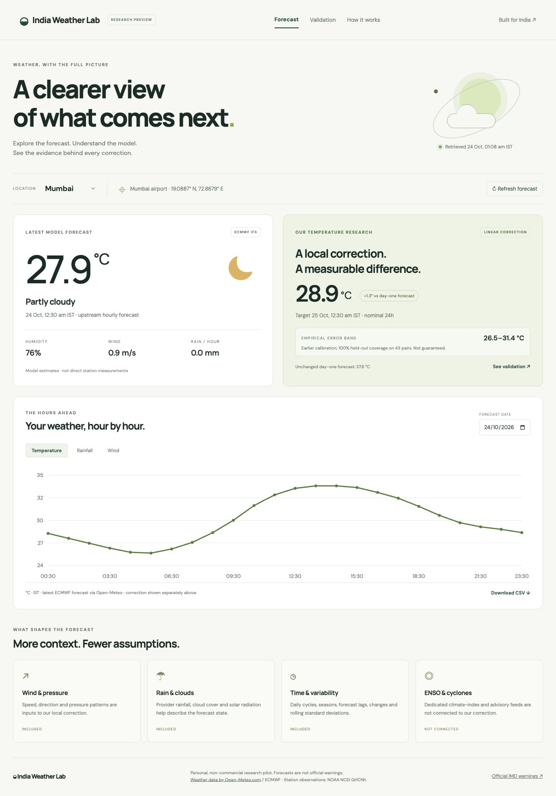
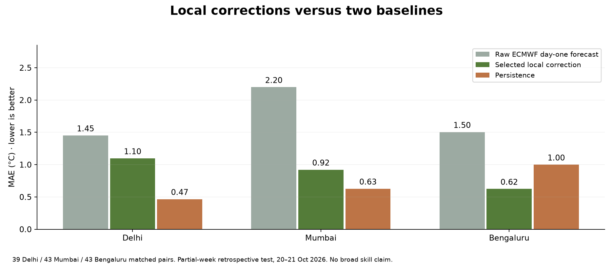
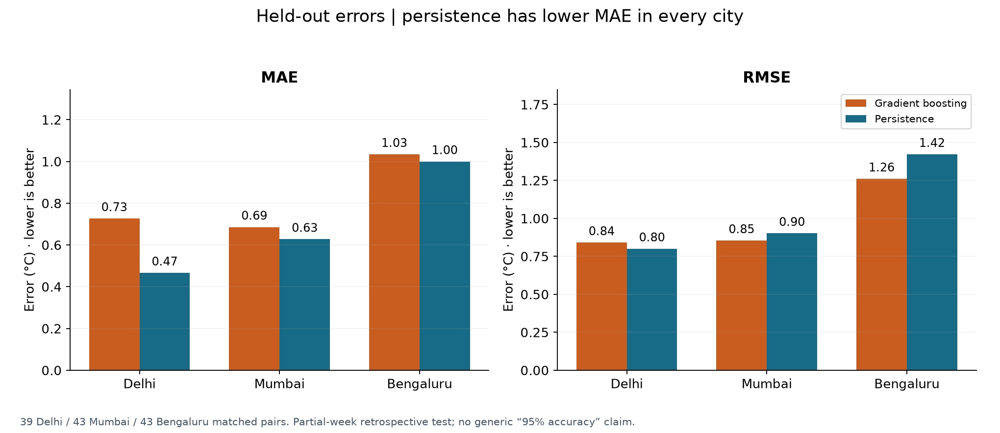
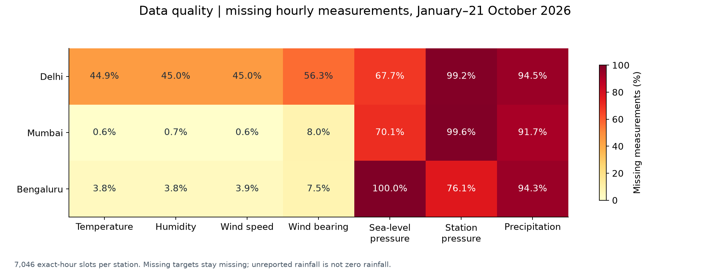
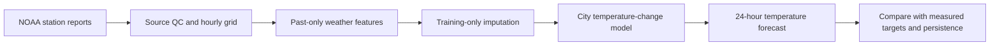
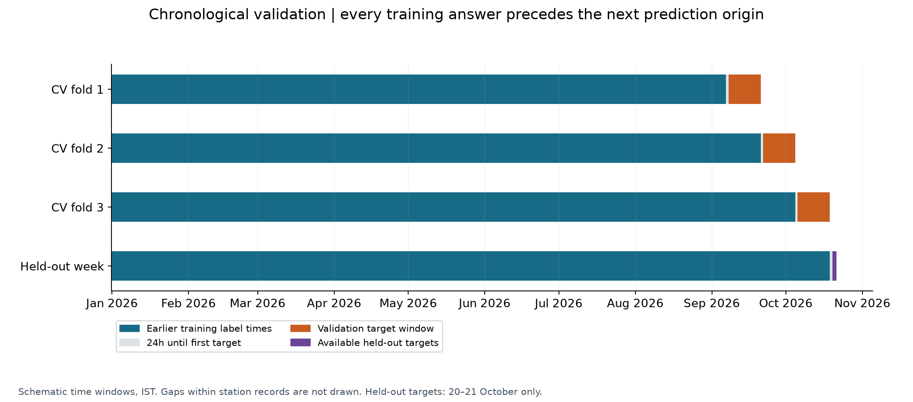
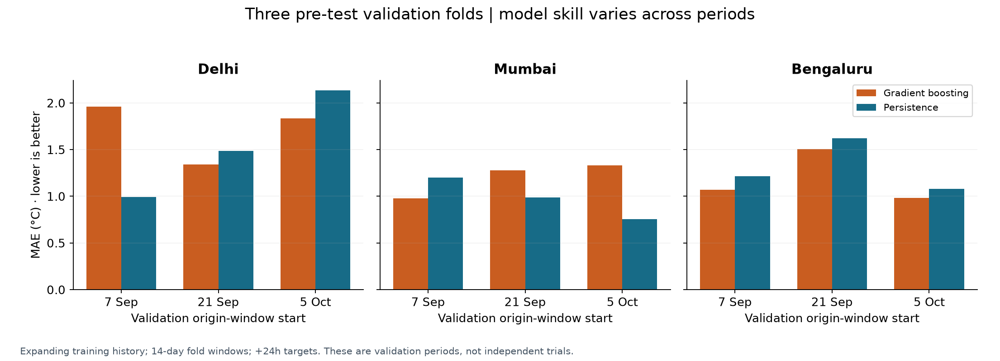
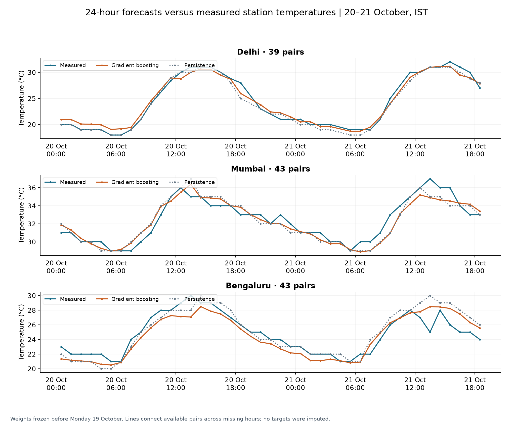
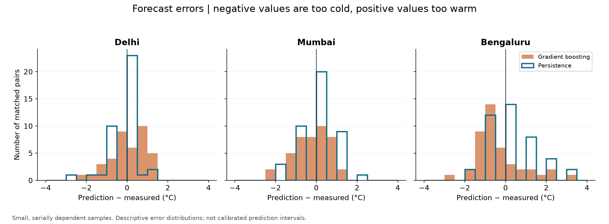

# India Temperature Forecast

## Version 0.2: live weather pilot and newly trained local corrections

The project now includes a live dashboard, FastAPI backend, Streamlit UI, Docker
Compose configuration and original local correction models trained on **2024–2026
station outcomes paired with archived ECMWF forecasts**. The original station-only
experiment below remains as a separate baseline; its results are not the new model's results.

**Public live dashboard:** [India Weather Lab](https://india-weather-kirti-lab.sid880088.chatgpt.site).
See [deployment status](docs/DEPLOYMENT.md) for scope and verification.



| City | Selected correction | Raw day-one forecast MAE | Corrected MAE | Persistence MAE |
|---|---|---:|---:|---:|
| Delhi | Boosted trees | 1.451°C | 1.097°C | **0.467°C** |
| Mumbai | Ridge regression | 2.200°C | 0.922°C | **0.628°C** |
| Bengaluru | Ridge regression | 1.505°C | **0.624°C** | 1.000°C |

These are matched partial-week results on 39/43/43 pairs, not proof of broad
operational skill. Corrections improve the raw provider forecast, but persistence
still wins in Delhi and Mumbai. The dashboard reports both baselines and states
that dedicated ENSO and cyclone advisory feeds are not connected.



Run the Python application in two terminals:

```bash
python -m pip install -r requirements-app.lock.txt
python -m pip install -e .
uvicorn app:app --host 127.0.0.1 --port 8000
# In another terminal, with the same environment activated:
streamlit run frontend.py
```

Alternatively run `docker compose up --build` (requires Docker). FastAPI is served
on port 8000 and Streamlit on 8501. The browser-only counterpart in `dashboard/`
uses exported numerical models and public weather APIs, so it can be hosted
without a Python runtime. It shows the same evaluated corrections and labels
them separately from the latest upstream forecast.

```bash
python -m unittest discover -s tests -v
node dashboard/scripts/test-portable.mjs
python -m http.server 8765 --directory dashboard/dist
```

Read the [live pilot guide](docs/LIVE_PILOT.md) for reproduction, model selection,
calibration, source availability and deployment limits.

---

**A reproducible, 24-hour temperature forecasting experiment using measured weather-station reports from Delhi, Mumbai, and Bengaluru.**

Python 3.12 · pandas · scikit-learn · NOAA GHCNh · chronological validation

This repository follows the full research path: download observations, audit their
quality, engineer past-weather features, train a model, compare against persistence,
and inspect errors. It includes a walkthrough notebook, three trained models,
machine-readable results, and publication-ready PNG/SVG figures.

> **Research result:** the first gradient-boosting model does **not** beat persistence
> on MAE in our small observed test. Targets cover **20–21 October 2026**, rather than a full
> week. This is a local research prototype, with no claim of 95% operational accuracy.



## Results at a glance

All errors are in °C. Lower is better. Persistence predicts tomorrow's temperature
as the measured temperature at the forecast origin, exactly 24 hours earlier.

| City | Training pairs | Test pairs | Model MAE | Persistence MAE | Model RMSE |
|---|---:|---:|---:|---:|---:|
| Delhi | 3,596 | 39 | 0.727 | **0.467** | 0.841 |
| Mumbai | 6,717 | 43 | 0.686 | **0.628** | 0.854 |
| Bengaluru | 6,332 | 43 | 1.035 | **1.000** | 1.261 |

See [all metrics](reports/metrics/week_2026-10-19/summary.csv),
[cross-validation results](reports/metrics/week_2026-10-19/cross_validation.csv), and
[every held-out prediction](reports/metrics/week_2026-10-19/all_predictions.csv).
The test week is now exposed; further model selection should use earlier validation
periods followed by a fresh held-out test.

The conclusion depends on the metric: ML has lower RMSE in Mumbai and Bengaluru
(0.854 vs 0.902°C and 1.261 vs 1.422°C), although persistence wins on MAE in every
city. Delhi's ML RMSE is 0.841°C versus persistence's 0.801°C. These samples are
too small to establish general superiority for either approach.

## Data and cleaning

The source is [NOAA NCEI's Global Historical Climatology Network hourly (GHCNh)](https://www.ncei.noaa.gov/products/global-historical-climatology-network-hourly),
a harmonized archive of station observations. This experiment uses the 2026 station/year
files, with a downloaded snapshot ending **21 October 2026**.

| City | Station | GHCNh ID | Missing hourly temperature after cleaning |
|---|---|---|---:|
| Delhi | Safdarjung | `INI0000VIDD` | 44.90% |
| Mumbai | Chhatrapati Shivaji airport | `INI0000VABB` | 0.55% |
| Bengaluru | HAL airport | `INM00043296` | 3.79% |

We preserve raw data locally, parse UTC timestamps, interpret source-specific QC
flags, apply broad physical bounds, reject conflicting duplicates, and retain
exact-hour reports on a regular hourly grid. Half-hour reports are excluded from
this first sampling policy. Missing labels are never filled. Short predictor gaps
may use earlier measurements; remaining imputation is fitted inside each training fold.

Rainfall is retained for inspection but excluded from the first model because
reporting is sparse and accumulation periods need further validation. Unreported
rainfall is never assumed to be zero. See the [data card](docs/DATA_CARD.md).



## Model

Each city has its own **HistGradientBoostingRegressor**. It predicts the next day's
temperature change, which is added to the measured origin temperature:

```text
forecast(t + 24h) = measured_temperature(t) + learned_change(features_at_t)
```

Inputs include temperature lags through 168 hours; rolling means, standard deviations
and observation counts over 3/6/24/72 hours; temperature deltas and rates over
1/3/24 hours; humidity, dew point and pressure; wind vectors; and sine/cosine clock
and seasonal features. Trees do not require scaling.

```python
HistGradientBoostingRegressor(
    max_iter=150,
    max_leaf_nodes=15,
    learning_rate=0.05,
    l2_regularization=10,
    early_stopping=False,
    random_state=42,
)
```

These are fixed starting parameters, not a claimed optimum. See the
[model card](docs/MODEL_CARD.md) for artifacts, feature semantics and limitations.



## Validation

Three expanding-history folds start on 7 September, 21 September and 5 October 2026.
Each validation window spans a fortnight. Training labels must precede its first
validation origin; +24-hour targets must fall before the window ends.

For the final fit, all training targets precede **19 October 00:00 IST**. Forecast
origins start on Monday, so the first eligible 24-hour target is Tuesday. Available
held-out targets run from **20 October 00:30 to 21 October 18:30 IST**. The model
weights remain fixed while rolling inputs update.





This is a retrospective replay. Archived corrections and unknown original report
arrival times limit claims about what a live system could have achieved. Sparse
reporting also changes which hours can be scored. See [validation details](docs/VALIDATION.md).

## Inspect the forecasts





Negative errors indicate cold forecasts; positive errors indicate warm forecasts.
These descriptive plots are not calibrated confidence or prediction intervals.

## Run locally in VS Code

Open this repository folder in VS Code. Use Python **3.12**; the saved models were
trained with scikit-learn **1.7.2**. For macOS/Linux:

```bash
python3.12 -m venv .venv
source .venv/bin/activate
python -m pip install -r requirements.lock.txt
python -m pip install -e .
```

For Windows PowerShell, activate using `.venv\Scripts\Activate.ps1`.

Start with offline checks and figures, which do not need station downloads:

```bash
python -m unittest discover -s tests -v
python -m india_weather.plots
```

Download and clean the observations, then reproduce training:

```bash
python -m india_weather.data --year 2026
python -m india_weather.model --year 2026 --week-start 2026-10-19
python -m india_weather.plots --week 2026-10-19
```

NOAA can revise its files. Compare new download fingerprints with the committed
[provenance records](data/provenance/) before claiming identical reproduction.
The downloader reuses local files by default; `--refresh` explicitly replaces them.

For the interactive walkthrough:

```bash
python -m pip install -e '.[notebook]'
```

Open [the notebook](notebooks/01_observations_to_forecast.ipynb), select the `.venv`
kernel and run one cell at a time. Start with Mumbai, then compare other stations.

## Use a saved model

The three [trained artifacts](models/week_2026-10-19/) include environment,
feature and SHA-256 metadata in [the manifest](models/week_2026-10-19/manifest.json).
After downloading/cleaning the station data, replay a known origin:

```bash
python -m india_weather.predict --city Mumbai --origin 2026-10-20T12:00:00Z
```

This reads only history through that origin and returns the +24-hour forecast.
It requires an observed origin and one week of history. It does not fetch current
weather or provide calibrated intervals. Only load trusted `.joblib` files;
[joblib/pickle loading can execute code](https://scikit-learn.org/1.7/model_persistence.html).

## Repository layout

```text
src/india_weather/    Download, QC, features, training, evaluation, prediction, plots
tests/               Offline scientific invariants and artifact/result checks
notebooks/           Guided observations-to-forecast walkthrough
data/provenance/     Published source URLs, retrieval times and input fingerprints
data/raw/            Local downloads (ignored by Git)
data/processed/      Local cleaned hourly data (ignored by Git)
models/              Three fitted research models and their manifest
reports/data_quality/ Missingness tables and cleaning audits
reports/metrics/     CV scores, per-city reports and held-out predictions
reports/figures/     Six GitHub-ready figures, each in PNG and SVG
docs/                Data card, model card, validation and contribution notes
.github/workflows/   Automated offline checks and figure generation
```

## Next research steps

- Extend observations to multiple complete years and review station consistency.
- Compare persistence, simpler regressions, station-only models and numerical-forecast correction.
- Audit rainfall, ENSO and publication-aware cyclone features before adding them.
- Evaluate on fresh periods, more weather regimes and unseen stations.
- Calibrate uncertainty before building a public forecast API and website.

## Attribution and license status

Credit NOAA NCEI GHCNh and its contributing observation sources; retain station
and source identifiers. Raw observations are downloaded rather than bundled in
this repository. Source terms remain separate from the project's code and artifacts.
See [data attribution and license status](docs/ATTRIBUTION.md). A software license
has not yet been selected for this project.

# India Temperature Forecast

## Version 0.2: live weather pilot and newly trained local corrections

The project now includes a live dashboard, FastAPI backend, Streamlit UI, Docker
Compose configuration and original local correction models trained on **2024–2026
station outcomes paired with archived ECMWF forecasts**. The original station-only
experiment below remains as a separate baseline; its results are not the new model's results.

**Public live dashboard:** [India Weather Lab](https://india-weather-kirti-lab.sid880088.chatgpt.site).
See [deployment status](docs/DEPLOYMENT.md) for scope and verification.


| City | Selected correction | Raw day-one forecast MAE | Corrected MAE | Persistence MAE |
|---|---|---:|---:|---:|
| Delhi | Boosted trees | 1.451°C | 1.097°C | **0.467°C** |
| Mumbai | Ridge regression | 2.200°C | 0.922°C | **0.628°C** |
| Bengaluru | Ridge regression | 1.505°C | **0.624°C** | 1.000°C |

These are matched partial-week results on 39/43/43 pairs, not proof of broad
operational skill. Corrections improve the raw provider forecast, but persistence
still wins in Delhi and Mumbai. The dashboard reports both baselines and states
that dedicated ENSO and cyclone advisory feeds are not connected.


Run the Python application in two terminals:

```bash
python -m pip install -r requirements-app.lock.txt
python -m pip install -e .
uvicorn app:app --host 127.0.0.1 --port 8000
# In another terminal, with the same environment activated:
streamlit run frontend.py
```

Alternatively run `docker compose up --build` (requires Docker). FastAPI is served
on port 8000 and Streamlit on 8501. The browser-only counterpart in `dashboard/`
uses exported numerical models and public weather APIs, so it can be hosted
without a Python runtime. It shows the same evaluated corrections and labels
them separately from the latest upstream forecast.

```bash
python -m unittest discover -s tests -v
node dashboard/scripts/test-portable.mjs
python -m http.server 8765 --directory dashboard/dist
```

Read the [live pilot guide](docs/LIVE_PILOT.md) for reproduction, model selection,
calibration, source availability and deployment limits.

---

**A reproducible, 24-hour temperature forecasting experiment using measured weather-station reports from Delhi, Mumbai, and Bengaluru.**

Python 3.12 · pandas · scikit-learn · NOAA GHCNh · chronological validation

This repository follows the full research path: download observations, audit their
quality, engineer past-weather features, train a model, compare against persistence,
and inspect errors. It includes a walkthrough notebook, three trained models,
machine-readable results, and publication-ready PNG/SVG figures.

> **Research result:** the first gradient-boosting model does **not** beat persistence
> on MAE in our small observed test. Targets cover **20–21 October 2026**, rather than a full
> week. This is a local research prototype, with no claim of 95% operational accuracy.


## Results at a glance

All errors are in °C. Lower is better. Persistence predicts tomorrow's temperature
as the measured temperature at the forecast origin, exactly 24 hours earlier.

| City | Training pairs | Test pairs | Model MAE | Persistence MAE | Model RMSE |
|---|---:|---:|---:|---:|---:|
| Delhi | 3,596 | 39 | 0.727 | **0.467** | 0.841 |
| Mumbai | 6,717 | 43 | 0.686 | **0.628** | 0.854 |
| Bengaluru | 6,332 | 43 | 1.035 | **1.000** | 1.261 |

See [all metrics](reports/metrics/week_2026-10-19/summary.csv),
[cross-validation results](reports/metrics/week_2026-10-19/cross_validation.csv), and
[every held-out prediction](reports/metrics/week_2026-10-19/all_predictions.csv).
The test week is now exposed; further model selection should use earlier validation
periods followed by a fresh held-out test.

The conclusion depends on the metric: ML has lower RMSE in Mumbai and Bengaluru
(0.854 vs 0.902°C and 1.261 vs 1.422°C), although persistence wins on MAE in every
city. Delhi's ML RMSE is 0.841°C versus persistence's 0.801°C. These samples are
too small to establish general superiority for either approach.

## Data and cleaning

The source is [NOAA NCEI's Global Historical Climatology Network hourly (GHCNh)](https://www.ncei.noaa.gov/products/global-historical-climatology-network-hourly),
a harmonized archive of station observations. This experiment uses the 2026 station/year
files, with a downloaded snapshot ending **21 October 2026**.

| City | Station | GHCNh ID | Missing hourly temperature after cleaning |
|---|---|---|---:|
| Delhi | Safdarjung | `INI0000VIDD` | 44.90% |
| Mumbai | Chhatrapati Shivaji airport | `INI0000VABB` | 0.55% |
| Bengaluru | HAL airport | `INM00043296` | 3.79% |

We preserve raw data locally, parse UTC timestamps, interpret source-specific QC
flags, apply broad physical bounds, reject conflicting duplicates, and retain
exact-hour reports on a regular hourly grid. Half-hour reports are excluded from
this first sampling policy. Missing labels are never filled. Short predictor gaps
may use earlier measurements; remaining imputation is fitted inside each training fold.

Rainfall is retained for inspection but excluded from the first model because
reporting is sparse and accumulation periods need further validation. Unreported
rainfall is never assumed to be zero. See the [data card](docs/DATA_CARD.md).


## Model

Each city has its own **HistGradientBoostingRegressor**. It predicts the next day's
temperature change, which is added to the measured origin temperature:

```text
forecast(t + 24h) = measured_temperature(t) + learned_change(features_at_t)
```

Inputs include temperature lags through 168 hours; rolling means, standard deviations
and observation counts over 3/6/24/72 hours; temperature deltas and rates over
1/3/24 hours; humidity, dew point and pressure; wind vectors; and sine/cosine clock
and seasonal features. Trees do not require scaling.

```python
HistGradientBoostingRegressor(
    max_iter=150,
    max_leaf_nodes=15,
    learning_rate=0.05,
    l2_regularization=10,
    early_stopping=False,
    random_state=42,
)
```

These are fixed starting parameters, not a claimed optimum. See the
[model card](docs/MODEL_CARD.md) for artifacts, feature semantics and limitations.


## Validation

Three expanding-history folds start on 7 September, 21 September and 5 October 2026.
Each validation window spans a fortnight. Training labels must precede its first
validation origin; +24-hour targets must fall before the window ends.

For the final fit, all training targets precede **19 October 00:00 IST**. Forecast
origins start on Monday, so the first eligible 24-hour target is Tuesday. Available
held-out targets run from **20 October 00:30 to 21 October 18:30 IST**. The model
weights remain fixed while rolling inputs update.


This is a retrospective replay. Archived corrections and unknown original report
arrival times limit claims about what a live system could have achieved. Sparse
reporting also changes which hours can be scored. See [validation details](docs/VALIDATION.md).

## Inspect the forecasts


Negative errors indicate cold forecasts; positive errors indicate warm forecasts.
These descriptive plots are not calibrated confidence or prediction intervals.

## Run locally in VS Code

Open this repository folder in VS Code. Use Python **3.12**; the saved models were
trained with scikit-learn **1.7.2**. For macOS/Linux:

```bash
python3.12 -m venv .venv
source .venv/bin/activate
python -m pip install -r requirements.lock.txt
python -m pip install -e .
```

For Windows PowerShell, activate using `.venv\Scripts\Activate.ps1`.

Start with offline checks and figures, which do not need station downloads:

```bash
python -m unittest discover -s tests -v
python -m india_weather.plots
```

Download and clean the observations, then reproduce training:

```bash
python -m india_weather.data --year 2026
python -m india_weather.model --year 2026 --week-start 2026-10-19
python -m india_weather.plots --week 2026-10-19
```

NOAA can revise its files. Compare new download fingerprints with the committed
[provenance records](data/provenance/) before claiming identical reproduction.
The downloader reuses local files by default; `--refresh` explicitly replaces them.

For the interactive walkthrough:

```bash
python -m pip install -e '.[notebook]'
```

Open [the notebook](notebooks/01_observations_to_forecast.ipynb), select the `.venv`
kernel and run one cell at a time. Start with Mumbai, then compare other stations.

## Use a saved model

The three [trained artifacts](models/week_2026-10-19/) include environment,
feature and SHA-256 metadata in [the manifest](models/week_2026-10-19/manifest.json).
After downloading/cleaning the station data, replay a known origin:

```bash
python -m india_weather.predict --city Mumbai --origin 2026-10-20T12:00:00Z
```

This reads only history through that origin and returns the +24-hour forecast.
It requires an observed origin and one week of history. It does not fetch current
weather or provide calibrated intervals. Only load trusted `.joblib` files;
[joblib/pickle loading can execute code](https://scikit-learn.org/1.7/model_persistence.html).

## Repository layout

```text
src/india_weather/    Download, QC, features, training, evaluation, prediction, plots
tests/               Offline scientific invariants and artifact/result checks
notebooks/           Guided observations-to-forecast walkthrough
data/provenance/     Published source URLs, retrieval times and input fingerprints
data/raw/            Local downloads (ignored by Git)
data/processed/      Local cleaned hourly data (ignored by Git)
models/              Three fitted research models and their manifest
reports/data_quality/ Missingness tables and cleaning audits
reports/metrics/     CV scores, per-city reports and held-out predictions
reports/figures/     Six GitHub-ready figures, each in PNG and SVG
docs/                Data card, model card, validation and contribution notes
.github/workflows/   Automated offline checks and figure generation
```

## Next research steps

- Extend observations to multiple complete years and review station consistency.
- Compare persistence, simpler regressions, station-only models and numerical-forecast correction.
- Audit rainfall, ENSO and publication-aware cyclone features before adding them.
- Evaluate on fresh periods, more weather regimes and unseen stations.
- Calibrate uncertainty before building a public forecast API and website.

## Attribution and license status

Credit NOAA NCEI GHCNh and its contributing observation sources; retain station
and source identifiers. Raw observations are downloaded rather than bundled in
this repository. Source terms remain separate from the project's code and artifacts.
See [data attribution and license status](docs/ATTRIBUTION.md). A software license
has not yet been selected for this project.